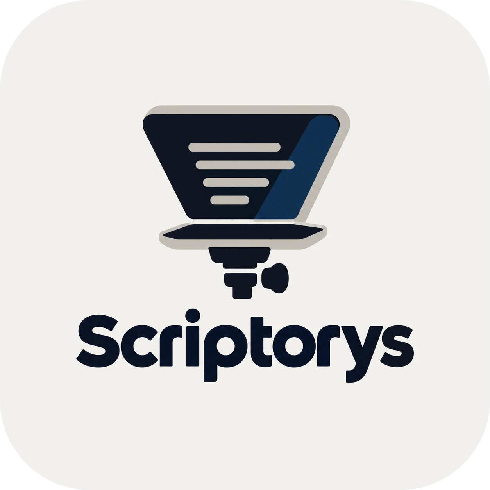
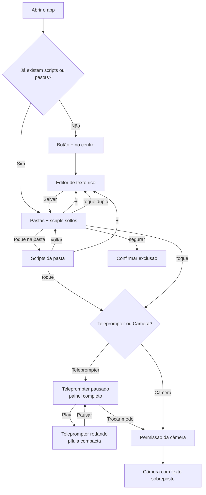

<p align="center">
  
</p>

<h1 align="center">Scriptorys</h1>

<p align="center">
  Teleprompter para Android: escreva seus roteiros com formatação, leia-os rolando na velocidade da sua fala
  e grave-se olhando para a câmera com o texto na tela.
</p>

<p align="center">
  
  
  
  
  
  
  
  
  
  
</p>

---

## Sumário

- [A ideia](#a-ideia)
- [Download](#download)
- [Funcionalidades](#funcionalidades)
- [Fluxo de funcionamento](#fluxo-de-funcionamento)
- [Como usar](#como-usar)
- [Gravação de vídeo e microfone externo](#gravação-de-vídeo-e-microfone-externo)
- [Controle remoto Bluetooth](#controle-remoto-bluetooth)
- [Tecnologias](#tecnologias)
- [Arquitetura e principais classes](#arquitetura-e-principais-classes)
- [Instalação](#instalação)
- [Testes](#testes)
- [Estrutura do projeto](#estrutura-do-projeto)

---

## A ideia

Quem grava vídeos, aulas, apresentações ou lives precisa falar olhando para a câmera sem decorar o texto.
O **Scriptorys** transforma o celular em um **teleprompter**: o roteiro sobe pela tela numa velocidade
compatível com a fala, e a pessoa só precisa ler.

O app foi pensado para três situações:

1. **Teleprompter de vidro** (como os da Ulanzi): o celular fica sob um vidro inclinado, que reflete o texto
   na frente da lente da câmera. Por isso o texto pode ser **espelhado** e controlado por um **controle Bluetooth**.
2. **Leitura direta na tela**: o celular fica de pé, na vertical ou na horizontal, mostrando o texto grande.
3. **Gravação com o próprio celular**: o modo **Câmera** mostra a imagem da câmera com o roteiro rolando por cima
   e **grava o vídeo**, inclusive com **microfone externo** (como o Hollyland), que a câmera nativa de muitos
   celulares ignora.

A velocidade é medida em **palavras por minuto (ppm)**, como na fala real. Assim, "120 ppm" significa o mesmo
ritmo em qualquer tamanho de letra ou de tela. Para quem prefere o jeito tradicional, há também o modo
**Rolagem**, com velocidade fixa de 0 a 10.

## Download

A versão **1.0.0** está na página de
[releases do GitHub](https://github.com/CookieSnack02/scriptorys/releases/tag/v1.0.0), com o APK pronto para
instalar no celular. Para instalar, permita "instalar apps desconhecidos" para o navegador ou gerenciador de
arquivos que abrir o APK.

## Funcionalidades

### Tela principal
- Na primeira vez, só aparece o botão **+** (`adicaoStory`) no centro da tela.
- Depois do primeiro roteiro, aparece a **lista de scripts** e o botão **+** vai para o canto inferior.
- Gestos em cada roteiro:

  | Gesto | Ação |
  |---|---|
  | Toque | Escolher entre **Teleprompter** e **Câmera** |
  | Toque duplo | **Editar** o roteiro |
  | Segurar | **Excluir** (pede confirmação) |

### Pastas (opcional)
- As pastas servem para organizar os roteiros, mas não são obrigatórias: quem não quiser usa tudo solto,
  como antes.
- **Criar pasta:** botão de pasta com **+** no canto superior direito da tela principal.
- **Abrir pasta:** toque nela. Dentro da pasta, o **+** cria o roteiro já nela; para voltar, use a seta ou
  o botão "voltar" do celular.
- **Renomear ou excluir:** segure a pasta. Excluir a pasta **não apaga** os roteiros: eles voltam a ficar
  soltos na tela principal.
- **Mover um roteiro:** no editor, toque em **Pasta: …** abaixo do título e escolha a pasta, **Sem pasta**
  ou **+ Nova pasta…**.
- Na tela principal aparecem primeiro as pastas (com a quantidade de roteiros) e depois os roteiros soltos.

### Editor de texto rico
- Título e corpo do roteiro.
- **Negrito**, *itálico*, <u>sublinhado</u>, ~~tachado~~, cor do texto, marca-texto e "limpar formatação".
- **Colar com formatação**: texto copiado do Word, Google Docs/Drive, navegadores e outros apps mantém negrito,
  itálico, sublinhado, tachado, cores, marca-texto e listas, tanto pelo menu **Colar** quanto pela barra de
  área de transferência do teclado (Gboard). Se o app de origem copiar só o texto puro (como a
  pré-visualização de PDF), o app avisa.
- Aviso ao sair com alterações não salvas.

### Teleprompter
- **Dois estados com animação entre eles:**
  - **Pausado:** painel completo com régua de velocidade, modo de velocidade, editar, opções de texto,
    configurações e os botões anterior / play / próximo.
  - **Rodando:** só uma pílula compacta com a régua de velocidade, ladeada por "voltar parágrafo" e "pausar".
- **Régua de velocidade**: arraste para os lados (com inércia), ou toque no bonequinho andando/correndo.
  Enquanto a régua se move, um **balão laranja acima do marcador mostra o valor** em que ela vai parar
  (também durante a leitura, na pílula compacta). Tocando na pílula "120 ppm ✏" você digita a velocidade exata.
- **Modos de velocidade**: *Palavras por minuto* (0 a 300) ou *Rolagem* (0 a 10).
- **Pular parágrafos** para frente e para trás, deslizando suavemente.
- **Opções de texto (botão TT)**: tamanho, fonte (serifada, sem serifa, monoespaçada, manuscrita) e alinhamento
  (esquerda, centro, direita, justificado).
- **Configurações (engrenagem)**: orientação (vertical/horizontal), espelhar na horizontal e/ou vertical,
  cor de fundo (preto, branco `#F9F7F0` e meio-termo `#2D2D2D`).
- **Instruções de cena**: trechos entre colchetes, como `[sorrir]` ou `[pausa]`, aparecem em laranja.
- Rolagem sempre suave: iniciar, pausar, mudar a velocidade e usar o controle aceleram e freiam aos poucos.
- Tela cheia e tela sempre ligada durante a leitura.
- As preferências ficam salvas para a próxima vez.

### Câmera
- Pede a permissão da câmera e mostra a imagem ao vivo (frontal ou traseira).
- O roteiro rola numa caixa sobre a imagem, com **posição** (topo, centro, base), **tamanho**, **cor** e
  **velocidade** ajustáveis. O texto aparece só na tela: **não sai no vídeo gravado**.
- **Gravar vídeo** (botão vermelho) com som do microfone escolhido. Veja a seção
  [Gravação de vídeo e microfone externo](#gravação-de-vídeo-e-microfone-externo).

## Fluxo de funcionamento



Por dentro, o caminho de um roteiro é este:

1. O **editor** guarda o texto formatado como **HTML** (`Html.deTexto`), dentro de um arquivo `scripts.json`
   no armazenamento interno do app (`ScriptRepository`). Cada roteiro pode ter um `pastaId`; as pastas ficam
   em `pastas.json`. Roteiro sem pasta (ou de uma pasta excluída) aparece solto na tela principal.
2. Ao abrir o teleprompter, o HTML volta a ser texto formatado (`Html.paraTexto`), e as instruções entre
   colchetes ganham cor.
3. A cada quadro de tela (`Choreographer`), a `RolagemAutomatica` calcula quantos pixels andar. Ela divide a
   altura do texto pelo número de palavras e multiplica pela velocidade em ppm. Depois soma o movimento do
   controle remoto, se houver.

## Como usar

1. Toque em **+** e escreva o roteiro (ou cole de outro app). Use a barra de formatação sobre o texto
   selecionado e toque em **Salvar**. Se quiser organizar, crie pastas no botão do canto superior direito e
   escolha a pasta em **Pasta: …** no editor.
2. Toque no roteiro e escolha **Teleprompter**.
3. Ajuste a velocidade na régua, o texto no botão **TT** e a orientação, o espelhamento e o fundo na **engrenagem**.
4. Toque em **▶** (ou em qualquer ponto do texto) para começar. O painel vira a pílula compacta.
5. Para pausar, toque em **⏸**, no texto ou no botão OK do controle.
6. Para gravar com o celular, use **Trocar modo** ou escolha **Câmera** na lista.

Dica para teleprompter de vidro: em **Configurações → Espelhar**, ative **Horizontal** para o reflexo
no vidro ficar legível.

## Gravação de vídeo e microfone externo

### Como gravar
1. Abra o roteiro em **Câmera** e toque no **botão vermelho**. Na primeira vez, o app pede permissão de
   microfone (sem ela, o vídeo é gravado sem som).
2. Durante a gravação, a pílula acima da barra mostra o **microfone em uso**, o **volume** e o **tempo**.
   A tela fica travada na orientação atual, para girar o celular não interromper o vídeo.
3. Toque no botão (agora um quadrado) para **parar**. O app junta imagem e som e mostra
   "Vídeo salvo em …" com o botão **Abrir**.

Sair da tela ou apagar o celular durante a gravação encerra e salva o vídeo.

### Onde ficam os vídeos (soltos ou em pastas)
Os vídeos vão para a galeria, em **Filmes (Movies) → Scriptorys**, com o nome do roteiro e a data
(ex.: `Aula 1 2026-10-22 14-30-05.mp4`):

| Opção | Pasta no celular |
|---|---|
| Sem pasta | `Movies/Scriptorys/` |
| Pasta "Aulas" | `Movies/Scriptorys/Aulas/` |

Por padrão o vídeo vai para a **mesma pasta do roteiro**. Para mudar, use **Configurações (engrenagem) →
Salvar vídeos em** na tela da câmera.

### Microfone externo (Hollyland e outros)
Toque na pílula **🎤** acima da barra para escolher o microfone:

- **Automático** (padrão): usa o melhor microfone externo conectado (USB, depois fone com fio, depois
  Bluetooth). Sem nenhum conectado, usa o do celular.
- Ou escolha um microfone específico da lista (ex.: **Hollyland Lark (USB)**).

Na mesma janela há um **teste de volume**: fale no microfone e veja a barra se mexer. A linha
**"Captando por: …"** mostra o microfone que o Android **realmente** está usando. Se o app pedir um
microfone e o Android usar outro, aparece um aviso também durante a gravação. Se o microfone escolhido for
desconectado, o app volta ao automático e avisa.

**Como conferir que o Hollyland está gravando:**
1. Conecte o receptor do Hollyland no celular (USB-C ou cabo de 3,5 mm).
2. Abra a pílula 🎤: o Hollyland deve aparecer na lista, e o automático já o escolhe.
3. Fale perto do **transmissor** (longe do celular): a barra deve se mexer e "Captando por" deve
   mostrar o Hollyland.
4. Grave alguns segundos e ouça o vídeo: o som deve ter a qualidade do microfone de lapela.
5. Para conferir a sincronia, bata uma palma de frente para a câmera e veja se som e imagem coincidem.

**Por que funciona onde a câmera nativa falha:** muitas câmeras nativas sempre gravam pelo microfone interno.
O CameraX (usado aqui) também não permite escolher o microfone, só o tipo de fonte. Por isso o app grava
**a imagem pelo CameraX** e **o som à parte**, pedindo ao Android exatamente o microfone escolhido
(`AudioRecord.setPreferredDevice`). Ao parar, os dois são **alinhados pelo relógio do sistema** e unidos
num único MP4 (`MediaMuxer`), sem perder qualidade (nada é recodificado na junção).

> Microfones **Bluetooth** comuns só gravam em qualidade de chamada, e alguns celulares não os liberam para
> gravação. Para o Hollyland, prefira o receptor **USB-C** ou o **cabo de 3,5 mm**.

Para diagnosticar, conecte o celular ao Android Studio e filtre o **Logcat** por `CameraActivity`:
a cada vídeo salvo aparece o microfone usado e o ajuste de sincronia aplicado.

## Controle remoto Bluetooth

O app aceita controles Bluetooth como o **MOCUTE-052** que acompanha os teleprompters **Ulanzi**, em qualquer
modo do controle (setas, mídia/volume, gamepad ou mouse):

| Botão do controle | Ação no teleprompter |
|---|---|
| Cima / Volume + / Page Up / alavanca para cima / roda para cima | Voltar o texto (um toque desliza ~1,5 linha; segurando, rola continuamente) |
| Baixo / Volume − / Page Down / alavanca para baixo / roda para baixo | Avançar o texto |
| Esquerda / Faixa anterior / L1 / alavanca para a esquerda | Diminuir a velocidade |
| Direita / Próxima faixa / R1 / alavanca para a direita | Aumentar a velocidade |
| OK / Enter / Espaço / Play-Pause / botão A | Iniciar ou pausar |

Para descobrir o que um botão envia, conecte o celular ao Android Studio e filtre o **Logcat** por
`ControleRemoto`.

## Tecnologias

| Item | Uso |
|---|---|
| **Kotlin 2.2.10** | Linguagem de todo o app |
| **Android SDK** (min 24 / target 37) | Plataforma: Android 7.0 ou superior |
| **Android Gradle Plugin 9.4.1 + Gradle 9.6.0** | Build, com Kotlin embutido no AGP |
| **AndroidX AppCompat, Core KTX, Activity KTX** | Base das telas, insets e tela cheia |
| **ConstraintLayout 2.2.2** (`ConstraintSet` + `TransitionManager`) | Layouts e animação entre os estados do painel |
| **RecyclerView 1.4.0** | Lista de scripts |
| **Material Components 1.14.0** (Material 3) | Botões, diálogos, painéis inferiores, sliders, chips |
| **CameraX 1.6.2** (`camera-camera2`, `camera-lifecycle`, `camera-view`, `camera-video`) | Prévia e gravação da imagem |
| **AudioRecord + MediaCodec (AAC)** | Gravação do som pelo microfone escolhido |
| **MediaExtractor + MediaMuxer** | Junção de imagem e som num MP4 |
| **MediaStore** | Salvar os vídeos na galeria (`Movies/Scriptorys`) |
| **jsoup 1.23.2** | Leitura do HTML copiado de Word/Docs ao colar |
| **org.json** (Android) | Gravação dos scripts em JSON |
| **JUnit + AndroidX Test** | Testes instrumentados |

## Arquitetura e principais classes

O app usa **Views + XML** (sem Jetpack Compose). Cada tela é uma `Activity`, e a lógica reutilizável fica
em classes pequenas.

| Arquivo | Responsabilidade | Principais funções |
|---|---|---|
| `MainActivity` | Tela principal, lista e escolha do modo | `carregar()`, `abrirEditor()`, `escolherModo()`, `confirmarExclusao()` |
| `ScriptAdapter` | Cartões de pastas e scripts, e os gestos (toque, toque duplo, segurar) | `GestureDetector` com `onSingleTapConfirmed`, `onDoubleTap`, `onLongPress`; `ItemLista.DePasta` / `ItemLista.DeScript` |
| `ScriptRepository` | Scripts (`scripts.json`) e pastas (`pastas.json`) | `listar()`, `listarNaPasta()`, `salvar()`, `excluir()`, `criarPasta()`, `renomearPasta()`, `excluirPasta()` |
| `DialogosPasta` | Diálogos de nome e de escolha de pasta | `pedirNome()`, `escolher()` |
| `EditorActivity` | Editor de texto rico | `alternar()` (liga/desliga estilo), `aplicarCor()`, `remover()`, `cobre()` |
| `Html` (em `EditorActivity.kt`) | Conversão texto formatado ↔ HTML | `deTexto()`, `paraTexto()` |
| `ColagemFormatada` | Colar mantendo a formatação de Word/Docs (CSS inline e por classes) | `ativar()`, `deHtml()`, `normalizar()`, `formatadoDaAreaDeTransferencia()` |
| `EditorTextoRico` | Campo do editor que reconhece a colagem feita pela barra do teclado | `onCreateInputConnection()` (intercepta `commitText`) |
| `TeleprompterActivity` | Tela do teleprompter | `alternarPlay()`, `mudarVelocidade()`, `irParaParagrafo()`, `abrirOpcoesTexto()`, `abrirConfiguracoes()` |
| `PainelTeleprompter` | Posições do painel e animação entre os estados | `mostrar(rodando, horizontal, animar)`, `completo()`, `compacto()` |
| `ReguaVelocidade` | Régua de velocidade desenhada à mão (`View` própria) | `configurar()`, `animarPara()`, `encaixar()`, `onDraw()`, `onTouchEvent()` |
| `RolagemAutomatica` | Motor de rolagem suave (ppm, rolagem fixa e controle) | `iniciar()`, `pausar()`, `parar()`, `empurrar()`, `segurar()`, `deslizarPara()`, `doFrame()` |
| `ControleRemoto` | Tradução das teclas/eixos do controle Bluetooth | `tecla(KeyEvent)`, `movimento(MotionEvent)` |
| `ConfigTeleprompter` | Preferências do teleprompter (`SharedPreferences`) | `carregar()`, `salvar()`, `corFundo()`, `corTexto()` |
| `CameraActivity` | Câmera com texto sobreposto e gravação de vídeo | `iniciarCamera()`, `alternarGravacao()`, `iniciarGravacao()`, `finalizarGravacao()`, `abrirEscolhaMicrofone()` |
| `Microfones` | Lista os microfones (celular, USB, fio, Bluetooth) e escolhe o automático | `listar()`, `automatico()`, `nome()` |
| `GravadorAudio` | Grava AAC pelo microfone escolhido, mede o volume e marca o início do som | `iniciar()`, `parar()`, `nivel`, `inicioNanos`, `dispositivoEmUso` |
| `MontadorVideo` | Junta imagem e som alinhados e salva na galeria | `juntar()`, `salvarNaGaleria()` |

## Instalação

### Requisitos
- **Android Studio** recente (com suporte ao AGP 9.4) e **JDK 17+** (o JBR que vem com o Android Studio serve).
- **Android SDK 37** instalado pelo SDK Manager.
- Um celular com **Android 7.0 ou superior**, ou um emulador.

### Pelo Android Studio
1. Clone o repositório:
   ```bash
   git clone https://github.com/CookieSnack02/scriptorys.git
   ```
2. Abra a pasta `scriptorys` no Android Studio e aguarde a sincronização do Gradle
   (ou use **File → Sync Project with Gradle Files**).
3. No celular, ative as **Opções do desenvolvedor → Depuração USB** e conecte-o ao computador.
4. Escolha o aparelho na barra superior e clique em **Run ▶**.

> Se o editor mostrar imports em vermelho logo após atualizar o projeto, sincronize o Gradle.
> Se continuar, use **File → Invalidate Caches → Invalidate and Restart**.

### Pela linha de comando
```bash
./gradlew assembleDebug
```
```bash
adb install -r app/build/outputs/apk/debug/app-debug.apk
```
No Windows, use `gradlew.bat assembleDebug`.

## Testes

Os testes instrumentados ficam em `app/src/androidTest`. `GravadorAudioTest` verifica a gravação de som
(arquivo AAC, duração, início marcado e microfone registrado) e o teste de volume. `ScriptRepositoryTest` verifica as pastas (criar,
renomear, mover roteiros e excluir a pasta sem perder os roteiros) e `ColagemFormatadaTest` verifica a colagem
com formatação
(HTML no formato do Google Docs, estilos por classe CSS, colagem no editor, colagem pela barra do teclado e
"colar como texto simples").

Para investigar uma colagem que perdeu a formatação, rode a versão de depuração e filtre o **Logcat** por
`ColagemFormatada`: aparecem os tipos copiados e a estrutura do HTML, sem o texto.

```bash
./gradlew connectedDebugAndroidTest
```

> **Atenção:** o comando roda em **todos** os aparelhos conectados e **desinstala o app ao final**, apagando
> os scripts salvos. Para usar só o emulador, defina antes a variável `ANDROID_SERIAL` com o nome dele
> (por exemplo, `emulator-5554`).

## Estrutura do projeto

```
app/src/main/
├── java/com/example/scriptorys/
│   ├── MainActivity.kt           # lista de scripts
│   ├── ScriptAdapter.kt          # cartões e gestos
│   ├── ScriptRepository.kt       # armazenamento de scripts e pastas (JSON)
│   ├── DialogosPasta.kt          # criar, renomear e escolher pastas
│   ├── EditorActivity.kt         # editor rico + conversão HTML
│   ├── ColagemFormatada.kt       # colar com formatação
│   ├── EditorTextoRico.kt        # campo do editor (colagem pelo teclado)
│   ├── TeleprompterActivity.kt   # tela do teleprompter
│   ├── PainelTeleprompter.kt     # estados e animação do painel
│   ├── ReguaVelocidade.kt        # régua de velocidade
│   ├── RolagemAutomatica.kt      # motor de rolagem
│   ├── ControleRemoto.kt         # controle Bluetooth
│   ├── ConfigTeleprompter.kt     # preferências
│   ├── CameraActivity.kt         # modo câmera e gravação de vídeo
│   ├── Microfones.kt             # lista e escolha de microfones
│   ├── GravadorAudio.kt          # gravação de som pelo microfone escolhido
│   ├── MontadorVideo.kt          # junta imagem e som e salva na galeria
│   └── Texto.kt                  # contagem de palavras
└── res/
    ├── layout/                   # telas, itens e painéis de opções
    ├── drawable/                 # ícones, fundos e logo
    └── values/                   # cores, textos e estilos
```
